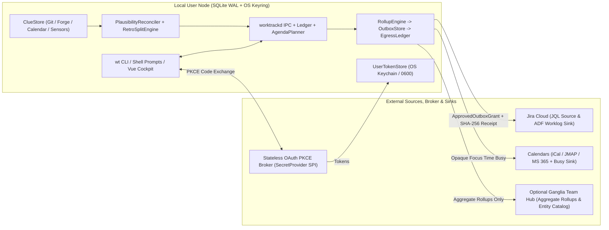

# Worktrack (`wt`)

**Low-key, anti-surveillance personal time ledger, Outbox rollup gateway, and keyboard-first planning cockpit.**

[](https://github.com/lino/worktrack/actions/workflows/ci.yml)
[](https://lino.github.io/worktrack/)
[](LICENSE)

`worktrack` (`wt` CLI, `worktrackd` local IPC daemon, and Django + DRF + Vue 3 cockpit) is a privacy-first time tracking and horizon planning tool built with Python 3.13+ (`uv` + `mise`), SQLite / PostgreSQL, and TypeScript (`@hey-api/openapi-ts` + `pinia-orm`).

Inspired by `collectd` and Ganglia telemetry pipelines, `worktrack` keeps raw personal time slices, notes, and ambient activity clues strictly on your local workstation while staging previewable, aggregated `Rollups` through an explicit `Outbox` before any external `Sink` (Jira Cloud, Calendar busy slots, or a team `Hub`) ever receives data.

______________________________________________________________________

## Core Design Principles

1. **Anti-Surveillance `collectd`/Ganglia Rollup Outbox**: Raw `Intervals`, personal notes, and local `Clues` never leave the local SQLite `Ledger` unpreviewed. Outbound writes stage as rounded `Rollup` items in `OutboxStore` with JSON dry-run diffs, require a sealed `ApprovedOutboxGrant`, and record immutable SHA-256 receipts in `EgressLedger`.
1. **Structured & Chaotic Capture + RetroSplit Reconciliation**: Clock in/out in real time (`wt in`, `wt out`) or capture coarse unallocated time blocks (`wt log`) and split them retrospectively (`wt split`, `wt reconcile`) using Git/Calendar `Clues`.
1. **Opaque OAuth Secret Sharing (`SecretProvider` SPI)**: Application-level OAuth `client_secret` values are resolved server-side via pluggable URIs (`env://`, `file://`, `keyring://`, or optional `aws-sm://` via `worktrack[aws]`) behind a stateless PKCE Confidential Token-Exchange Broker. Per-user OAuth tokens remain strictly in the user's local OS Keychain (`UserTokenStore`).
1. **Weighted Multi-Entity Attribution DAG**: Attribute `Activities` and `Entities` across `project`, `component`, `customer`, `epic`, and `cost_center` nodes with cycle-checked transitive weight propagation.
1. **Local ContextFacts & Workplace Sensors**: Track daily or interval-scoped facts such as `workplace=home_office|office|mobile_work` (manual or inferred locally from subnet CIDR, Wi-Fi SSID, VPN interface, or display count) and export annual tax-return statements (`CSV`, `JSON`, `Markdown`).

______________________________________________________________________

## Architecture Overview



______________________________________________________________________

## Ubiquitous Language

| Canonical Term                  | Meaning                                                                                                              |
| ------------------------------- | -------------------------------------------------------------------------------------------------------------------- |
| **`Interval`**                  | Bounded time slice (`[started_at, ended_at)`) recorded in `structured` or `chaotic` (unallocated) mode.              |
| **`Activity`**                  | Trackable work unit: **Targeted** (finite deliverable such as `PROJ-123`) or **Standing** (recurring `Meetings`).    |
| **`Entity` & `Attribution`**    | Weighted many-to-many DAG linking `Activities` to `project`, `component`, `customer`, `epic`, or `cost_center`.      |
| **`Facet` & `ContextFact`**     | Typed user-configurable dimension (e.g. `workplace=home_office\|office\|mobile_work`) asserted on a date/slice.      |
| **`Collector` / `Sensor`**      | Local observer (Git commits, GitHub/GitLab MRs, Calendar events, network/display probe) emitting local `Clues`.      |
| **`Reconciler` / `RetroSplit`** | Plausibility detector and duration-conserving splitter (`proportional`, `equal`, `weights`) for unbooked work.       |
| **`Rollup` -> `Outbox`**        | `collectd`-style aggregator and previewable staging queue gating all outbound `Sink` writes (`ApprovedOutboxGrant`). |
| **`EgressLedger`**              | Append-only local audit log recording timestamp, destination `Sink`, and SHA-256 payload digest for every write.     |
| **`Agenda` & `FocusBlock`**     | Horizon planner (*Now*, *Today*, *This Week*) and scheduled deep-work windows (optionally published as busy).        |

______________________________________________________________________

## Quickstart

### 1. Install Toolchain & Dependencies

Using [`mise`](https://mise.jdx.dev/) and [`uv`](https://docs.astral.sh/uv/):

```sh
mise install
mise run setup
```

Or directly with `uv` and `pnpm`:

```sh
uv sync --locked --dev
pnpm -C frontend install --frozen-lockfile
```

### 2. Track Time, ContextFacts & Horizons (`wt` CLI)

```sh
# Start and stop structured work intervals
wt in PROJ-123 --title "Implement Outbox diff preview" --tag backend
wt out --note "Completed unit tests"

# Record today's workplace for tax-return summaries
wt fact set workplace=home_office

# Capture a chaotic (unallocated) block and split it retrospectively
wt log --start 13:00 --end 15:00 --note "Afternoon debugging"
wt split <interval-id> PROJ-123=75m Meetings=45m

# Inspect Now / Today / This Week horizons and Agenda
wt now
wt today
wt week
wt agenda add PROJ-123 --horizon today --priority 1 --budget 120
wt agenda focus --start 2026-11-08T09:00:00Z --end 2026-11-08T11:00:00Z --label "Deep Work" --expose-busy
```

### 3. Collect Clues, Evaluate Sensors & Reconcile Gaps

```sh
# Scan local Git commits into local ClueStore (zero external egress)
wt clue git-sync --repo .
wt clue list

# Evaluate local workplace sensor rules (CIDR, SSID, VPN, display count)
wt sensor evaluate --apply

# Detect unbooked Activities / chaotic blocks and apply a proportional RetroSplit
wt reconcile inspect
wt reconcile propose --interval-id <interval-id> --activity PROJ-123 --activity PROJ-456 --strategy proportional
wt reconcile apply --interval-id <interval-id> --activity PROJ-123 --activity PROJ-456 --strategy proportional
```

### 4. Preview Outbox Diffs, Sync Calendars & Export Reports

```sh
# Stage, preview, approve, and flush aggregated Rollups
wt outbox preview --sink jira --cadence eod
wt outbox approve <outbox-item-id>
wt outbox flush --sink jira
wt outbox ledger

# Import iCal (.ics) meetings or stage FocusBlocks as opaque "Focus Time" busy slots
wt calendar sync --ics-file calendar.ics
wt calendar stage-focus --start 2026-11-08T00:00:00Z --end 2026-11-09T00:00:00Z

# Generate annual workplace tax-return or multi-entity attribution reports
wt export tax --year 2026 --format markdown
wt export attribution --start 2026-11-01T00:00:00Z --end 2026-11-08T00:00:00Z --format csv
```

### 5. Launch the Browser Cockpit & Local IPC Daemon

```sh
# Start the local sub-10ms IPC socket daemon for shell prompts
wt daemon --background

# Launch the Django/DRF API backend (http://127.0.0.1:8000)
wt serve

# In another terminal, launch the Vue 3 + Vuetify keyboard cockpit
pnpm -C frontend run dev
```

| Keyboard Chord | Cockpit Action                                           |
| -------------- | -------------------------------------------------------- |
| `Ctrl+K` / `:` | Open native `<dialog>` Command Palette                   |
| `?`            | Open Keyboard Shortcut Help modal                        |
| `f`            | Switch to **Now & Insights** view                        |
| `p`            | Switch to **Today / Week Agenda & FocusBlocks** view     |
| `c`            | Switch to **Chaotic Interval & Attribution Editor** view |
| `o`            | Switch to **Outbox Diff Preview & EgressLedger** view    |
| `s`            | Switch to **Reconciler, Clues & Workplace Sensors** view |

______________________________________________________________________

## Shell Prompt Integration (`< 10 ms` p95)

`wt status --porcelain` queries `worktrackd` over a `0600` Unix domain socket (or authenticated loopback TCP on Windows) and exits in `< 15 ms` with an empty output when `worktrackd` is offline so your shell prompt never hangs:

- **`starship.rs`**: Copy [`shell/starship/starship.worktrack.toml`](shell/starship/starship.worktrack.toml) into `$XDG_CONFIG_HOME/starship.toml`.
- **`oh-my-zsh`**: Source [`shell/zsh/worktrack.plugin.zsh`](shell/zsh/worktrack.plugin.zsh) and add `$(worktrack_prompt_info)` to `PROMPT` or `RPROMPT`.
- **PowerShell**: `Import-Module ./shell/powershell/WorktrackPrompt.psm1`.

______________________________________________________________________

## Development & Verification Gates

```sh
mise run verify        # ruff + mypy --strict + frontend hygiene/typecheck + pytest (173) + vitest (10)
mise run bench         # BENCH-SPEC-WT latency benchmarks (IPC, rollup preview, attribution DAG, secrets)
mise run openapi-sync  # Export drf-spectacular OpenAPI 3.1 schema & regenerate @hey-api/openapi-ts client
mise run docs          # Build strict Zensical User & Operations manuals (site/)
```

______________________________________________________________________

## Documentation & License

- **User Guide**: [`docs/user/guide.md`](docs/user/guide.md)
- **Operations & Alert Runbook**: [`docs/operations/runbook.md`](docs/operations/runbook.md)
- **License**: Licensed under the [Apache License, Version 2.0](LICENSE).
