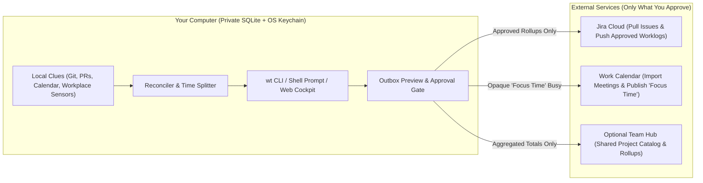

# Worktrack (`wt`)

**Track your time, plan your week, and log hours to Jira — without giving up your privacy.**

[](https://github.com/lino/worktrack/actions/workflows/ci.yml)
[](https://lino.github.io/worktrack/)
[](LICENSE)

**Worktrack (`wt`)** is a personal time tracker and daily/weekly planner for people who live in the terminal and the browser. It helps you keep track of what you worked on, stay focused, and report hours to Jira, calendars, or tax forms — while keeping your raw timeline and personal notes strictly on your own computer.

📖 **Full Documentation**: [https://lino.github.io/worktrack/](https://lino.github.io/worktrack/)

______________________________________________________________________

## What Worktrack Can Do for You

### ⏱️ Track time your way — live or at the end of the day

- **Clock in as you go**: Start and stop timers from the terminal (`wt in`, `wt out`) or the keyboard-driven web app.
- **Or log rough blocks and split them later**: Had a chaotic afternoon and forgot to switch timers? Record a single block (`wt log --start 13:00 --end 17:00`) and divide it across tasks whenever you are ready (`wt split`).

### 🔒 Share rounded summaries, never your raw timeline

- **Everything starts on your machine**: Your exact start/stop times, personal scratch notes, and local activity hints are stored in a local SQLite database on your workstation.
- **An Outbox you control**: Nothing is ever sent to Jira, your calendar, or a team server behind your back. When you are ready to report time, Worktrack rounds and groups your hours into an **Outbox** where you can preview the exact changes and approve what gets sent.

### 🧩 Reconstruct your day without guessing

- **Automatic local breadcrumbs**: Worktrack can scan your local Git commits, GitHub/GitLab pull and merge requests, and calendar meetings to remind you what you worked on.
- **Smart end-of-day reconciliation**: If you committed code to two tickets during an unallocated afternoon block, `wt reconcile` spots the gap and suggests a proportional time split in one command.

### 🎯 Plan your day and protect your focus time

- **Three clear horizons**: See what is on your plate for **Right Now**, **Today**, and **This Week** (`wt now`, `wt today`, `wt week`).
- **Calendar focus blocks**: Schedule deep-work windows (`wt agenda focus`) and optionally publish them to your work calendar as simple `"Focus Time"` busy slots — so colleagues know you are heads-down without seeing your internal task notes.

### 🏠 Effortless home-office & project reports

- **Work-location tracking for tax returns**: Log whether you worked from `home_office`, `office`, or `mobile_work` each day — either with `wt fact set workplace=home_office` or automatically based on your local Wi-Fi, network subnet, VPN, or connected monitors. Export a ready-to-file annual summary (`Markdown`, `CSV`, or `JSON`) at tax time.
- **Multi-project & customer breakdowns**: Link tasks across projects, components, customers, epics, and cost centers (for example, splitting a shared platform task 60% / 40% between two products) and export clean time reports.

### ⚡ Always visible in your shell prompt

- Drop-in prompt plugins for **`starship.rs`**, **`oh-my-zsh`**, and **PowerShell** show your current task and elapsed time right in your terminal prompt in under `10 ms`.

______________________________________________________________________

## Quickstart

### 1. Install Worktrack

Using [`mise`](https://mise.jdx.dev/) and [`uv`](https://docs.astral.sh/uv/):

```sh
mise install
mise run setup
```

Or directly with `uv` and `pnpm`:

```sh
uv sync --locked --dev
pnpm -C frontend install --frozen-lockfile
```

### 2. Everyday Terminal Workflow (`wt`)

```sh
# Start and stop a timer on a task
wt in "Fix login redirect" --ref PROJ-123
wt out --note "Added regression test"

# Forgot to run a timer? Log a block and split it across tasks later
wt log "Afternoon bug triage" --at 2026-11-08T13:00:00Z --end 2026-11-08T15:00:00Z --chaotic
wt split <interval-id> --part "PROJ-123 Build=75m" --part "Team Sync=45m"

# Record where you worked today (for your annual tax-return export)
wt fact set workplace=home_office --date 2026-11-08

# Check your day and week at a glance
wt now
wt today
wt week
```

### 3. Let Worktrack Help You Fill In the Blanks

```sh
# Scan your local Git commits for ticket references (stays 100% local)
wt clue git-sync --repo .
wt clue list

# Detect where you are working today from local network/display rules
wt sensor evaluate --apply

# Find unbooked time and split it across the tickets you touched
wt reconcile inspect
wt reconcile propose --interval-id <interval-id> --activity <act-1> --activity <act-2> --strategy proportional
wt reconcile apply --interval-id <interval-id> --activity <act-1> --activity <act-2> --strategy proportional
```

______________________________________________________________________

## Connecting to Jira Cloud (Login, Sync & Worklogs)

Worktrack connects to Jira Cloud so you can pull your assigned issues into your local task list and push approved time logs back to Jira when you are ready.

Your Jira credentials are stored in your operating system's native credential store (**macOS Keychain**, **Linux Secret Service / KWallet**, or **Windows Credential Manager**) — never in plain-text config files.

### Step 1: Set your Jira Cloud site ID

Tell Worktrack which Jira Cloud site you use by setting `WORKTRACK_JIRA_CLOUD_ID` in your shell profile:

```sh
export WORKTRACK_JIRA_CLOUD_ID="your-atlassian-cloud-id"
```

> **Tip — How to find your Jira Cloud ID:**
> Open `https://<your-company>.atlassian.net/_edge/tenant_info` in your browser while signed in to Jira. It returns a small JSON snippet like `{"cloudId": "01234567-89ab-cdef-0123-456789abcdef"}`.

### Step 2: Log in to Jira (`wt jira login`)

You can sign in either via an OAuth 2.0 browser flow (recommended when your team runs a shared Worktrack OAuth broker so nobody has to distribute a `client_secret`) or by storing an OAuth token directly.

#### Option A: Browser OAuth 2.0 Login (PKCE)

1. Generate your login link and one-time PKCE verifier:

   ```sh
   export WORKTRACK_JIRA_CLIENT_ID="your-oauth-app-client-id"
   export WORKTRACK_JIRA_REDIRECT_URI="http://127.0.0.1:5173/callback"

   wt jira auth-url --json
   ```

1. Open the `authorization_url` from the output in your browser and click **Accept** on the Atlassian consent screen.

1. Copy the `code` parameter from the redirect URL and exchange it into your local OS Keychain:

   ```sh
   wt jira login --code "<authorization-code>" --code-verifier "<code-verifier-from-step-1>"
   ```

#### Option B: Direct Token Login

If you already have a Jira OAuth 2.0 access token (and optional refresh token), save it directly into your OS Keychain:

```sh
wt jira login \
  --access-token "<your-jira-oauth-access-token>" \
  --refresh-token "<optional-refresh-token>"
```

#### Verify or sign out at any time

```sh
# Check whether your workstation is signed in (never prints your secret token)
wt jira status

# Remove your stored Jira credentials from the OS Keychain
wt jira logout
```

### Step 3: Pull your assigned Jira issues (`wt jira sync`)

Once logged in, pull your assigned Jira issues into Worktrack:

```sh
# Sync open issues assigned to you (and their projects & components)
wt jira sync

# Or pass a custom JQL filter
wt jira sync --jql 'project = PROJ AND assignee = currentUser() AND status != Done'
```

Now you can clock in against any synced issue by key (`wt in "PROJ-123"`).

### Step 4: Preview and send worklogs to Jira (`wt outbox`)

Worktrack never posts time to Jira automatically while you are working. Instead, you stage, preview, and approve rounded worklogs in your **Outbox**:

```sh
# 1. Preview and stage rounded worklogs for Jira
wt outbox preview --sink jira --stage --cadence eod

# 2. Approve the staged worklog item(s) you want to send
wt outbox list
wt outbox approve <outbox-item-id>

# 3. Send approved worklogs to Jira Cloud
wt outbox flush --sink jira

# 4. View your local receipt log (with SHA-256 audit digests)
wt outbox ledger
```

______________________________________________________________________

## Calendars, Tax Reports & Browser Cockpit

### Sync Calendars & Publish Focus Time

```sh
# Import meetings from a calendar (.ics file, Fastmail JMAP, or Microsoft 365)
wt calendar sync --ics-file calendar.ics

# Stage scheduled Focus Blocks as opaque "Focus Time" busy slots on your calendar
wt calendar stage-focus --start 2026-11-08T00:00:00Z --end 2026-11-09T00:00:00Z
```

### Export Tax & Project Reports

```sh
# Annual home-office / office / mobile-work summary for your tax return
wt export tax --year 2026 --format markdown

# Time breakdown across projects, customers, epics, and cost centers
wt export attribution --start 2026-11-01T00:00:00Z --end 2026-11-08T00:00:00Z --format csv
```

### Launch the Browser Cockpit

Prefer a visual interface with fast keyboard shortcuts? Run the local API server and Vue 3 cockpit:

```sh
# Start the local background daemon for instant (< 10 ms) shell prompt updates
wt daemon --background

# Start the local API server (http://127.0.0.1:8000)
wt serve

# In another terminal, start the web cockpit
pnpm -C frontend run dev
```

| Shortcut       | What It Opens                                      |
| -------------- | -------------------------------------------------- |
| `Ctrl+K` / `:` | Command Palette (search and run any action)        |
| `?`            | Keyboard Shortcut Help                             |
| `f`            | **Now & Insights** (live timer & daily progress)   |
| `p`            | **Today / Week Agenda & Focus Blocks**             |
| `c`            | **Chaotic Interval Splitter & Attribution Editor** |
| `o`            | **Outbox Preview, Approval & Receipt Log**         |
| `s`            | **Reconciler, Git/Calendar Clues & Exports**       |

______________________________________________________________________

## Shell Prompt Integration

Display your active timer in your shell prompt without slowing down your terminal (`< 10 ms` response time, and exits silently when idle):

- **`starship.rs`**: Copy [`shell/starship.toml`](shell/starship.toml) into `$XDG_CONFIG_HOME/starship.toml`.
- **`oh-my-zsh`**: Source [`shell/worktrack.plugin.zsh`](shell/worktrack.plugin.zsh) and add `$(worktrack_prompt_info)` to `PROMPT` or `RPROMPT`.
- **PowerShell**: Add `Import-Module ./shell/WorktrackPrompt.psm1` to your PowerShell profile.

______________________________________________________________________

## How It Works Under the Hood



______________________________________________________________________

## Documentation & License

- **Online Manual**: [https://lino.github.io/worktrack/](https://lino.github.io/worktrack/)
- **User Guide**: [`docs/user/guide.md`](docs/user/guide.md)
- **Developer & Architecture Guide**: [`docs/developer/guide.md`](docs/developer/guide.md)
- **License**: Licensed under the [Apache License, Version 2.0](LICENSE).
