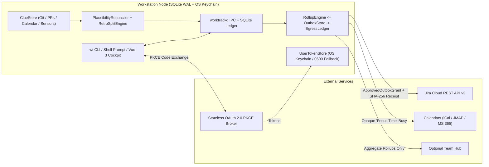

# Developer & Architecture Guide

This guide is for contributors, self-hosters, and curious users who want to understand how Worktrack (`wt`) works under the hood, customize advanced configuration files, or build and test the project from source.

If you just want to use Worktrack day-to-day, see the **[User Guide](../user/guide.md)**.

______________________________________________________________________

## Architecture Overview: How Privacy & Performance Work Under the Hood

Worktrack is designed around three technical guarantees:

1. **Local-First Storage (`Ledger`)**: All raw time slices (`Intervals`), notes, work-location facts (`ContextFacts`), and local activity hints (`Clues`) are stored in a local SQLite database (`WAL` mode) on your workstation.
1. **Cryptographically Gated Outbox (`OutboxStore` & `ApprovedOutboxGrant`)**: External connectors (`JiraWorklogSink`, `CalendarFocusSink`, `GangliaHubSink`) cannot read your raw `Intervals` or transmit data on their own. First, `RollupEngine` aggregates and rounds your time into previewable `OutboxItem` proposals. Only when you approve an item does Worktrack mint a signed `ApprovedOutboxGrant` token allowing the connector to send that specific payload, recording a SHA-256 receipt in `EgressLedger`.
1. **Fast Shell-Prompt Helper (`worktrackd`)**: Spawning a Python interpreter on every shell prompt redraw would feel sluggish. When `wt daemon` is running, `wt status --porcelain` queries `worktrackd` over a local `0600` Unix domain socket (or loopback TCP on Windows) in under `10 ms`, and exits immediately if the daemon is stopped so your terminal never hangs.



______________________________________________________________________

## Core Domain Concepts

When reading or contributing to the codebase (`src/worktrack/` and `frontend/src/`), you will encounter these domain terms:

| Term                             | What It Represents in the Codebase                                                                   |
| -------------------------------- | ---------------------------------------------------------------------------------------------------- |
| `Interval`                       | A recorded time slice (`[started_at, ended_at)`) in `structured` (clock in/out) or `chaotic` mode.   |
| `Activity`                       | A trackable unit of work: **Targeted** (e.g. Jira ticket `PROJ-142`) or **Standing** (e.g. Triage).  |
| `Entity` & `Attribution`         | Weighted many-to-many directed acyclic graph (`0.0 < weight <= 1.0`) linking tasks to projects/orgs. |
| `Facet` & `ContextFact`          | Typed local metadata (such as `workplace=home_office`) attached to a date or `Interval`.             |
| `Collector` / `Sensor` -> `Clue` | Local observers (Git commits, PRs/MRs, calendar events, network rules) that write local `Clues`.     |
| `Reconciler` & `RetroSplit`      | Plausibility detector and duration-conserving splitter (`proportional`, `equal`, `weights`).         |
| `Rollup` -> `Outbox` -> `Sink`   | Aggregator and staging queue that gates all outbound writes to external services (`Sinks`).          |
| `EgressLedger`                   | Append-only local audit log recording timestamp, destination URI, and SHA-256 payload digest.        |
| `Agenda` & `FocusBlock`          | Daily/weekly planner items and scheduled deep-work windows.                                          |
| `Node` / `Hub`                   | Personal workstation SQLite `Node` vs. optional shared Django/PostgreSQL `Hub` + OAuth Broker.       |

______________________________________________________________________

## Development Setup & Build Commands

Worktrack uses:

- **Backend**: Python 3.13+, SQLite / PostgreSQL, Django 5, Django REST Framework, and `drf-spectacular` (OpenAPI 3.1).
- **Frontend**: TypeScript, Vue 3, Vuetify, `@hey-api/openapi-ts`, and `pinia-orm`.
- **Tooling**: [`mise`](https://mise.jdx.dev/), [`uv`](https://docs.astral.sh/uv/), and `pnpm`.

```bash
# Install toolchain and dependencies
mise install
mise run setup

# Run linters, strict type checks, and the full test suite
mise run verify
```

| Task Command            | What It Runs                                                                                |
| ----------------------- | ------------------------------------------------------------------------------------------- |
| `mise run setup`        | Initializes local cache directories and installs locked Python (`uv`) and frontend (`pnpm`) |
| `mise run openapi-sync` | Exports the OpenAPI 3.1 schema (`openapi.json`) and regenerates `@hey-api/openapi-ts` types |
| `mise run lint`         | Runs `ruff`, `mypy --strict`, frontend hygiene checks, and `vue-tsc --noEmit`               |
| `mise run test`         | Runs the Python `pytest` suite and frontend `vitest` suite                                  |
| `mise run verify`       | Runs both `mise run lint` and `mise run test`                                               |
| `mise run bench`        | Runs latency benchmarks for IPC status, Outbox rollup preview, attribution DAG, and secrets |
| `mise run docs`         | Builds the documentation site (`uvx zensical build --strict`) into `site/`                  |
| `mise run metrics`      | Prints local Prometheus / OpenMetrics counters and histograms to standard output            |

______________________________________________________________________

## Configuration & Environment Variables Reference

Worktrack resolves configuration across three layers (**Environment Variables** > **TOML Config File** > **XDG Base Directories**) so no file paths are ever hardcoded:

| Setting                | Environment Variable                 | TOML Key (`[worktrack]`)   | Default XDG Path / Value                     |
| ---------------------- | ------------------------------------ | -------------------------- | -------------------------------------------- |
| Configuration File     | `WORKTRACK_CONFIG_FILE`              | *(file path)*              | `$XDG_CONFIG_HOME/worktrack/config.toml`     |
| Local Ledger Database  | `WORKTRACK_DB_PATH`                  | `db_path`                  | `$XDG_DATA_HOME/worktrack/ledger.sqlite3`    |
| Daemon IPC Socket      | `WORKTRACK_SOCKET_PATH`              | `socket_path`              | `$XDG_RUNTIME_DIR/worktrack/worktrackd.sock` |
| Telemetry State Dir    | `WORKTRACK_TELEMETRY_DIR`            | `telemetry_dir`            | `$XDG_STATE_HOME/worktrack/telemetry`        |
| Metrics HTTP Bind Host | `WORKTRACK_METRICS_HOST`             | `metrics_host`             | `127.0.0.1`                                  |
| Metrics HTTP TCP Port  | `WORKTRACK_METRICS_PORT`             | `metrics_port`             | `9112`                                       |
| Metrics Shutdown Wait  | `WORKTRACK_METRICS_SHUTDOWN_TIMEOUT` | `metrics_shutdown_timeout` | `5.0`                                        |
| Deployment Topology    | `WORKTRACK_MODE`                     | `mode`                     | `node` (`node` or `hub`)                     |
| Log Level              | `WORKTRACK_LOG_LEVEL`                | `log_level`                | `INFO`                                       |

Example `$XDG_CONFIG_HOME/worktrack/config.toml`:

```toml
[worktrack]
mode = "node"
metrics_host = "127.0.0.1"
metrics_port = 9112
log_level = "INFO"
```

______________________________________________________________________

## Running with Docker & Inspecting Metrics

You can run Worktrack in a container using the included `Dockerfile` and `compose.yaml`:

```bash
docker compose up --build -d
curl -fsS http://127.0.0.1:9112/healthz
curl -fsS http://127.0.0.1:9112/metrics
```

Or inspect local Prometheus metrics directly from your checkout:

```bash
uv run python -m worktrack.telemetry
uv run python -m worktrack.telemetry --serve --host 127.0.0.1 --port 9112
```
