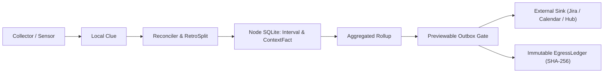

# Worktrack (`wt`) — Privacy-First Personal Time Ledger

**Worktrack** (`wt`) is a low-key, anti-surveillance personal time allocation ledger and daily/weekly planning cockpit built on Python 3.13+, SQLite / PostgreSQL, Django + Django REST Framework + `drf-spectacular`, and Vue 3 + Vuetify + `@hey-api/openapi-ts` + `pinia-orm`.

## Architectural Privacy Boundary

Worktrack enforces a strict separation between user-owned raw personal records and previewed external aggregates:

## Canonical Ubiquitous Language

| Concept                          | Responsibility                                                                          |
| -------------------------------- | --------------------------------------------------------------------------------------- |
| `Interval`                       | Raw recorded time span (structured clock-in/out or chaotic unallocated capture).        |
| `Activity`                       | Work classification (*Targeted* deliverable work vs. *Standing* recurring overhead).    |
| `Entity` & `Attribution`         | Many-to-many link attributing an `Interval` across projects, tickets, or initiatives.   |
| `Facet` & `ContextFact`          | User-owned personal metadata (for example `workplace=home_office`) kept strictly local. |
| `Collector` / `Sensor` -> `Clue` | Ambient local hints (Git commits, calendar events) aiding retrospective attribution.    |
| `Reconciler` & `RetroSplit`      | Interactive splitting and attribution of chaotic or overlapping `Intervals`.            |
| `Rollup` -> `Outbox` -> `Sink`   | Previewed aggregate payload staged before reaching any external `Sink`.                 |
| `EgressLedger`                   | Append-only SHA-256 receipt log recording every user-approved `Outbox` flush.           |
| `Agenda` & `FocusBlock`          | Daily/weekly capacity planning blocks optionally published as calendar busy markers.    |
| `Node` / `Hub`                   | Personal local SQLite `Node` vs. optional shared Django/PostgreSQL `Hub` + Broker.      |

## Documentation Manuals

- **[User Guide](user/guide.md)**: Developer and end-user onboarding, layered XDG and environment configuration, `Schaltwerk` workflow routing, and CLI telemetry usage.
- **[Operations Runbook](operations/runbook.md)**: Hub and `Freigabeamt` governance, `Uhrenmaschine` Prometheus metrics and alert triage, `FRITZ_TRACE_ID` structured logging, Secret Isolation (`PROB-WT-001`), and Docker runtime operations.
